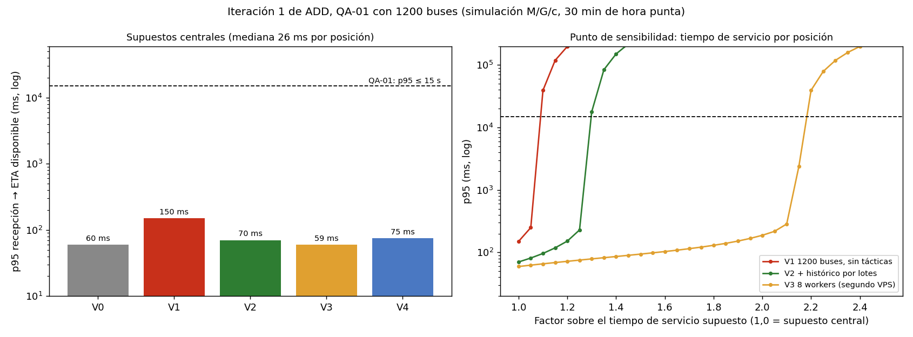

# Iteración 1 de ADD: QA-01 (ingesta y ETA con 1200 buses)

## 1. Entradas
| Insumo | Origen | Qué aporta |
|--------|--------|------------|
| Drivers y restricciones | `drivers.md` (Lab 04) | R-01 (1 mes), R-02 (1 developer), R-03 (un servidor); QA-01: ETA ≤ 15 s (p95) |
| Estilo y decisiones | ADR-001, ADR-002, ADR-003 | Monolito modular, polling con caché corta, PostgreSQL + PostGIS sin Redis (Redis solo si las pruebas de carga lo exigen) |
| Patrones | ADR-005 (Lab 07) | Puertos, adaptadores y Decorator: base para agregar tácticas sin reescribir |
| Modelo C4 | `workspace.dsl` (Lab 06) | ⚠️ No revisado en esta iteración; se actualiza en E6 |
| Escenarios | `utilidad/escenarios.md` (E1) | Crecimiento a 1200 buses (120 mensajes/s) y 50 000 consultas por hora punta |

## 2. Objetivo
Escenario **QA-01 (H,H)**: con 1200 buses enviando su posición cada 10 s (120 mensajes/s), el ETA debe estar disponible en **≤ 15 s (p95)** desde la recepción. Es el escenario de mayor prioridad y dificultad.
ADR-003 dejó una condición explícita: evaluar Redis solo si las pruebas de carga lo exigen. Esta iteración comprueba si, con cuatro veces la carga, esa condición se cumple.

## 3. Elemento refinado
Camino de ingesta: API REST (token por bus) → módulo Ubicaciones (estado actual e histórico) → módulo ETA (recálculo incremental) → PostgreSQL + PostGIS.

## 4. Conceptos de diseño evaluados (Prompt IA 2)
| Concepto | Qué mejora | Qué empeora | Decisión |
|----------|------------|-------------|----------|
| Microservicios + Kafka | Aislamiento y escala horizontal | Operar un broker y varios servicios; contradice ADR-001, R-01, R-02 y R-03 | **Rechazado.** La simulación muestra que el monolito cumple QA-01 con la carga de 1200 buses (p95 de 60 a 150 ms frente a 15 s) |
| Redis para el estado actual (V4) | Baja el costo de la escritura del estado | Un componente más que operar y una fuente de pérdida de estado al reiniciarse; ADR-003 lo admite solo si se exige | **Rechazado.** Margen de 1,27x, casi igual al del histórico por lotes (1,30x) que no agrega componentes |
| Histórico por lotes fuera del camino crítico (V2) | Menos tiempo de servicio por posición; más margen | El histórico se retrasa unos segundos y una caída puede perder un lote del histórico (no del estado actual) | **Aceptado** |
| Escalar a 8 workers con un segundo VPS (V3) | Margen de 2,17x | Duplica el costo mensual (R-03) | **Plan B** |

## 5. Evidencia: simulación M/G/c (`fitness/rendimiento.py`, `fitness/graficos.py`)
Medida: la misma de QA-01, **p95 desde la recepción de la posición hasta que el ETA queda disponible**, con 30 min de hora punta simulada y semilla 7. El margen es el factor máximo sobre los tiempos de servicio que aún cumple QA-01.

| Variante | p50 (ms) | p95 (ms) | Utilización | ¿Cumple QA-01? | Margen |
|----------|---------:|---------:|------------:|:--------------:|-------:|
| V0 control: 300 buses, sin tácticas | 26 | 60 | 0,27 | Sí | 3,76x |
| V1 1200 buses, sin tácticas | 59 | 150 | 0,93 | Sí | 1,08x |
| V2 + histórico por lotes | 29 | 70 | 0,78 | Sí | 1,30x |
| V3 8 workers (segundo VPS) | 26 | 59 | 0,46 | Sí | 2,17x |
| V4 Redis para el estado actual | 31 | 75 | 0,79 | Sí | 1,27x |

Con otras 5 semillas, el p95 de V1 varió entre 144 y 195 ms y el de V2 entre 69 y 73 ms; los márgenes (1,08x, 1,30x y 2,17x) se repitieron con 3 semillas.

**Medición real (solo CPU, sin base de datos):** `fitness/medir_logica.py` ejecutó el código del Lab 07. Procesar una posición y recalcular los ETA de una ruta de 40 paraderos toma una **mediana de 0,08 ms** (p95 de 0,11 ms). El recálculo no es el cuello de botella: lo son las operaciones de base de datos, cuyo costo es un supuesto.

### Supuestos (deben reemplazarse por mediciones del prototipo)
1. 4 workers de Django en un solo VPS; el tamaño real del VPS no está definido (R-03).
2. Mediana de servicio por posición de 26 ms (framework y token 10, estado actual 5, ETA 6, histórico 5). **No fue medida.**
3. Tiempos lognormales con sigma = 0,5.
4. Cada bus envía cada 10 s con fase aleatoria y jitter de 0,3 s.
5. Las lecturas (50 000 por hora, 13,9/s) comparten los workers y tardan 12 ms de mediana; se interpretó "50 000 consultas" como por hora.
6. El histórico por lotes agrupa 10 inserciones (5 ms pasan a 0,5 ms por posición).
7. Redis baja el componente de estado de 5 a 1 ms.
8. No se modelan bloqueos de base de datos, pausas de recolección de basura ni latencia de red.

## 6. Decisión y análisis
**¿Se cumple QA-01?** Sí, bajo los supuestos: el p95 va de 60 a 150 ms frente al presupuesto de 15 000 ms. ⚠️ No está verificado con mediciones reales.

**Hallazgo principal (punto de sensibilidad):** sin tácticas, la utilización es de 0,93 y el margen es de solo 1,08x. QA-01 deja de cumplirse si la mediana del tiempo de servicio por posición supera **≈ 28 ms** con 4 workers; ahí la cola crece sin límite y el p95 pasa de milisegundos a minutos (figura, panel derecho). Con 8 workers el umbral sube a ≈ 56 ms.

**Decisión:**
1. Adoptar el **histórico por lotes** (margen 1,30x, sin componentes nuevos).
2. Mantener **8 workers / segundo VPS como plan B**.
3. **Rechazar** Redis y microservicios con Kafka. Se mantiene el ADR-001 y no se activa la condición de ADR-003.
4. ⚠️ Disparador propuesto: revisar si la mediana medida en el prototipo supera 22 ms (≈ 80 % del umbral de 28 ms).

**Trade-off aceptado (ADR-006, E6):** rendimiento de la ingesta frente a durabilidad del histórico (puede perder un lote tras una caída). El estado actual se escribe de forma síncrona y no se pierde.

**Nota:** QA-01 se mide en el servidor. El ETA que ve el pasajero puede tener hasta 5 s más por la caché del proxy y hasta 10 s más por el intervalo de polling (ADR-002).
