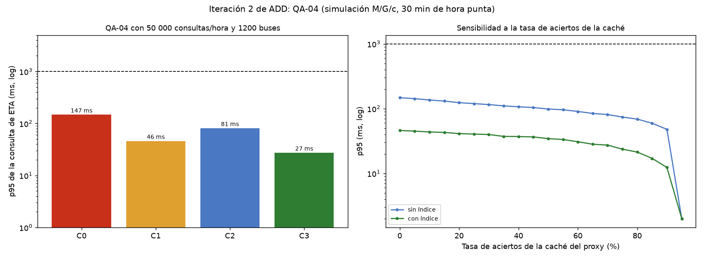

# Iteración 2 de ADD: QA-04 (consultas de ETA en hora punta)

## Entradas y objetivo
Partimos de la iteración 1 (ingesta con histórico por lotes) y de ADR-002 (polling con caché de proxy de 3 a 5 s). Objetivo: escenario **QA-04 (H,M)**: 50 000 consultas de ETA en la hora punta (13,9 por segundo) con la ingesta de 1200 buses activa; **p95 ≤ 1 s**.
Elemento refinado: API de consulta, proxy inverso y la consulta SQL del ETA por paradero.

## Conceptos de diseño evaluados
| Concepto | Qué mejora | Qué empeora | Decisión |
|----------|------------|-------------|----------|
| Índice en la consulta del ETA por paradero | Tiempo de servicio de cada consulta | Escrituras algo más lentas y más espacio en disco | **Aceptado** |
| Caché del proxy con TTL de 3 a 5 s (ADR-002) | Menos consultas llegan al origen | Hasta 5 s más de antigüedad percibida | Aceptado (ya decidido en ADR-002); aporta poco margen en este modelo |
| WebSocket | Actualización inmediata | Conexiones persistentes y reconexiones; contradice ADR-002 | **Rechazado:** las consultas cumplen con polling |
| Segundo VPS o réplica de lectura | Capacidad | Duplica el costo (R-03) | Plan B |

## Evidencia (`fitness/consultas.py`)
Simulación M/G/c con el pool de 4 workers compartido entre ingesta y lecturas; 30 min de hora punta, semilla 7. Medida: p95 de la respuesta a la consulta, igual que QA-04.

| Variante | p95 lectura (ms) | p95 ingesta (ms) | Utilización | ¿Cumple QA-04? | Margen |
|----------|-----------------:|-----------------:|------------:|:--------------:|-------:|
| C0 sin tácticas | 147 | 115 | 0,89 | Sí | 1,12x |
| C1 solo índice | 46 | 68 | 0,76 | Sí | 1,31x |
| C2 solo caché (70 %) | 81 | 73 | 0,78 | Sí | 1,28x |
| C3 índice + caché (70 %) | 27 | 66 | 0,74 | Sí | 1,35x |

### Supuestos (no medidos)
1. Consulta sin índice: mediana de 40 ms; con índice: 8 ms.
2. Una respuesta de la caché tarda 2 ms y no usa workers; cuando los aciertos superan el 95 %, el p95 global es el de la caché.
3. Tasa de aciertos central de 70 %.
4. La ingesta usa el histórico por lotes (21,5 ms de mediana) y se mantienen los supuestos de la iteración 1.
5. El costo del índice sobre las escrituras no está en el modelo.

## Hallazgos y decisión
1. **QA-04 se cumple en todas las variantes** bajo los supuestos (27 a 147 ms frente a 1000 ms). ⚠️ No verificado con mediciones reales.
2. **El índice es la táctica dominante:** baja el p95 de 147 a 46 ms. La caché agrega poco (46 a 27 ms).
3. **La tasa de aciertos de la caché no es un punto de sensibilidad aquí:** la curva es casi plana hasta el 90 % (figura, panel derecho). La sensibilidad real es la utilización del pool compartido con la ingesta (margen de 1,12x a 1,35x).
4. Decisión: adoptar el índice, mantener la caché de ADR-002 y rechazar WebSocket. El segundo VPS queda como plan B.
5. Trade-off aceptado: la caché agrega hasta 5 s de antigüedad percibida (QA-04 y QA-01 se miden en el servidor). El índice debe cubrir una columna que no cambia al actualizar, para no impedir las actualizaciones HOT de PostgreSQL.