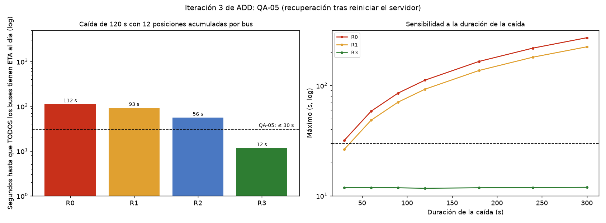

# Iteración 3 de ADD: QA-05 y QA-02 (disponibilidad)

## Entradas y objetivo
Esta iteración mitiga el riesgo crítico **R2** del ATAM-lite (reconexión masiva tras una caída con ingesta casi saturada) y cubre disponibilidad.
Escenarios: **QA-05 (M,M)** reinicio del servidor en hora punta: ETA al día en ≤ 30 s tras reanudarse la ingesta; y **QA-02 (H,L)** bus sin señal: "desactualizado" en ≤ 30 s y 0 errores para los otros 1199.
Elemento refinado: API de ingesta y módulos Ubicaciones y ETA.

## Conceptos de diseño evaluados
| Concepto | Qué mejora | Qué empeora | Decisión |
|----------|------------|-------------|----------|
| FIFO sin cambios (R0, R1) | Nada que construir | La ráfaga se procesa completa antes de llegar a la posición más reciente | Insuficiente (92 a 112 s) |
| Ampliar a 8 workers (R2) | Drena la ráfaga más rápido | Duplica el costo (R-03) | **Rechazado con evidencia:** 55,9 s, no cumple |
| Cola persistente de pendientes (Redis o Kafka) | No se pierden mensajes | Un componente más; contradice ADR-001 y ADR-003 | **Rechazado:** no hace falta guardar lo que los buses ya conservan |
| Priorizar la posición más reciente de cada bus; las anteriores solo al histórico por lotes (R3) | ETA al día sin esperar el atraso | El histórico se completa después | **Aceptado** |

## Evidencia (`fitness/recuperacion.py`)
Caída de 120 s con 12 posiciones acumuladas por bus; medida: segundos hasta que el ETA de **todos** los buses está al día.

| Variante | p95 (s) | Máximo (s) | ¿Cumple QA-05? |
|----------|--------:|-----------:|:--------------:|
| R0 FIFO, sin tácticas | 106,1 | 111,9 | No |
| R1 FIFO + histórico por lotes | 87,8 | 92,6 | No |
| R2 FIFO con 8 workers | 53,1 | 55,9 | No |
| R3 última posición primero + lotes | 10,9 | 11,7 | **Sí** |

Con 3 semillas el máximo de R3 varió entre 11,6 y 12,0 s. En FIFO la recuperación crece con la caída (R1: 26 s con 30 s de caída, 48 s con 60 s, 93 s con 120 s, 224 s con 300 s), mientras que R3 se mantiene en ≈ 12 s para cualquier duración.

### Supuestos (no medidos)
1. Los buses acumulan las posiciones no enviadas y las reenvían al reconectarse; si no las acumulan, no hay ráfaga y QA-05 se cumple sin táctica.
2. Reconexión con retraso de 0 a 10 s por bus; ráfaga de la más antigua a la más nueva.
3. La posición más reciente cuesta 21,5 ms; cada anterior, 0,5 ms por el histórico en lote.
4. Se mantienen los supuestos de la iteración 1 (4 workers, 13,9 lecturas/s).
5. No está implementado en el código del Lab 07: falta un `recibir_lote(placa, posiciones)` que procese la más reciente y envíe las demás al histórico.

## QA-02: bus sin señal
- El estado "desactualizado" se deriva de la marca de tiempo al consultar, y los timeouts de un bus se publican como `sin_senal` sin afectar a los demás. Está probado en `test_posicion_de_mas_de_30_segundos_da_eta_desactualizado` y `test_tres_timeouts_registran_sin_senal_y_no_hay_eta`.
- **Límite:** la medida de 30 s es del servidor. El pasajero puede verlo hasta 15 s después (caché de 5 s y polling de 10 s), o sea ≤ 45 s percibidos.

## Decisión
Adoptar la priorización de la posición más reciente con el resto al histórico por lotes. Cumple QA-05 (11,7 s frente a 30 s) y mitiga R2. Trade-off aceptado: el histórico puede completarse con retraso tras una caída. QA-02 se mantiene por diseño y se protegerá con una fitness function en E5.